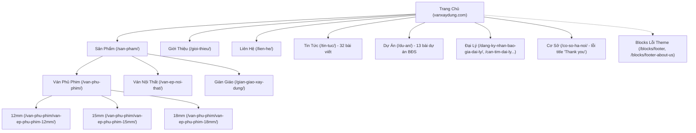
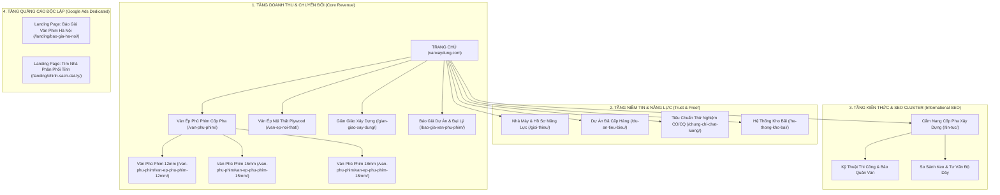
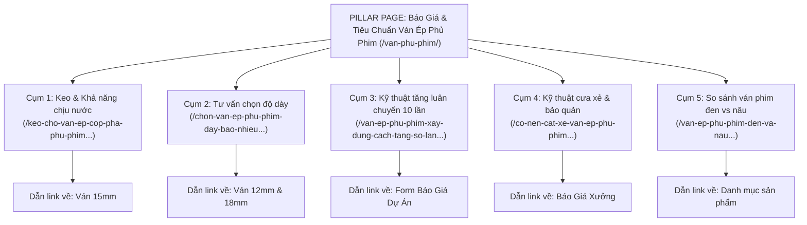
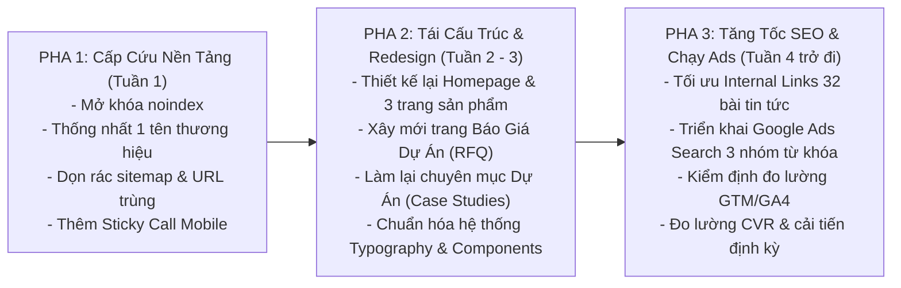

# Báo Cáo Kiểm Tra Hiện Trạng & Phương Án Cải Thiện Toàn Diện Website vanxaydung.com
*(Website Growth Audit & Redesign Action Plan)*

---

## 0. Hồ Sơ Dự Án

- **Website kiểm định:** `https://vanxaydung.com`
- **Doanh nghiệp / Đơn vị vận hành ghi nhận:** Công Ty Cổ Phần Tư Vấn Thiết Kế Và Xây Dựng V-HOME (thông tin trên website xuất hiện thêm các tên: "Tú Anh 68", "Lạc Việt Plywood", "Vanphuphimvn.com").
- **Ngành nghề & Mô hình:** B2B Sản xuất & Phân phối Vật liệu xây dựng (Ván ép phủ phim cốp pha, ván ép nội thất plywood, giàn giáo xây dựng).
- **Thị trường mục tiêu:** Nhà thầu xây dựng, đơn vị thi công coppha, đại lý phân phối vật liệu xây dựng tại Hà Nội, Miền Bắc và toàn quốc.
- **Ngày đánh giá:** 24/10/2026.
- **Phạm vi kiểm tra thực tế:** 100% các trang cốt lõi gồm Trang chủ, 15 Pages (`/page-sitemap.xml`), 32 Posts (`/post-sitemap.xml`), 13 Featured Items (`/featured_item-sitemap.xml`), hệ thống tệp `robots.txt`, `sitemap_index.xml` và mã nguồn HTML tĩnh.
- **Mục tiêu chuyển đổi ưu tiên:** Khách B2B gửi Yêu cầu Báo giá dự án/đại lý (RFQ), Gọi Hotline kinh doanh, Nhắn Zalo tư vấn kỹ thuật, Đặt mẫu ván thử nghiệm tại chân công trình.
- **Nguồn & Công cụ kiểm định:** HTTP Requests, HTML Parser bóc tách DOM, Yoast XML Sitemap Parser, WordPress CMS Inspector, phân tích thẻ Meta/Schema/Tracking.
- **Giới hạn kiểm định:** Chưa được cấp quyền truy cập nội bộ Google Analytics 4 (GA4), Google Search Console (GSC), Google Ads Account; chỉ số tốc độ trang Core Web Vitals cần đối chiếu thêm qua Chrome User Experience Report (CrUX).

---

## 1. Executive Summary — Góc Nhìn Người Ra Quyết Định

### 1.1. Chẩn đoán chính
Website `vanxaydung.com` sở hữu thế mạnh rất lớn về mặt sản phẩm cốt lõi (ván ép phủ phim - mặt hàng tiêu hao khối lượng lớn trong mọi công trình xây dựng) và có sẵn hệ thống bài viết phong phú về kiến thức ngành. Tuy nhiên, **website hiện tại đang ở trạng thái KHÔNG THỂ TẠO RA DOANH THU TỰ NHIÊN** do mắc phải 2 lỗi tê liệt ở tầng nền tảng:
1. **Lỗi chặn Google Index toàn trang (`noindex, nofollow`):** Toàn bộ 49+ URL của website đang tự đóng cửa với Google, khiến website hoàn toàn biến mất trên kết quả tìm kiếm tự nhiên.
2. **Xung đột 4 thương hiệu trên cùng một website:** Tên công ty, tên nhà máy và tên miền xuất hiện lộn xộn (V-HOME, Tú Anh 68, Lạc Việt Plywood, Vanphuphimvn.com), tạo cảm giác website bị sao chép cẩu thả, triệt tiêu niềm tin của các nhà thầu lớn khi cần ký hợp đồng tiền tỷ.

### 1.2. Top 5 cơ hội & Vấn đề sống còn cần xử lý ngay

| # | Hiện trạng có bằng chứng thực tế | Ảnh hưởng đến kinh doanh | Giải pháp ưu tiên | Tác động mong đợi | Mức độ |
|:---:|---|---|---|---|:---:|
| **1** | Thẻ `<meta name="robots" content="noindex, nofollow">` xuất hiện trên 100% trang quét được. | Website vô hình 100% trên Google Search; mất toàn bộ khách hàng tự nhiên tìm kiếm ván cốp pha. | Tắt ngay tùy chọn chặn index trong Cài đặt Đọc (WordPress Admin); cấu hình lại Yoast SEO. | Website xuất hiện lại trên Google; bài viết và trang sản phẩm bắt đầu đón lượt xem tự nhiên. | **P0** (Khẩn cấp) |
| **2** | Xuất hiện đồng thời 4 tên thương hiệu (V-HOME, Tú Anh 68, Lạc Việt, Vanphuphimvn.com) và 3 hotline khác nhau. | Khách hàng B2B, chủ thầu nghi ngờ website lừa đảo, giả mạo hoặc đơn vị cò mồi thương mại trung gian. | Thống nhất 1 nhận diện pháp nhân: Công ty V-HOME - Nhà máy Ván Phủ Phim Tú Anh 68; chuẩn hóa 1 tổng đài hotline. | Tăng uy tín thương hiệu, nâng tỷ lệ gọi điện và gửi yêu cầu báo giá từ các nhà thầu lớn. | **P0** (Khẩn cấp) |
| **3** | Chuyên mục Dự Án (`/du-an/`) copy nguyên văn bài PR bán căn hộ Vinhomes, Tân Hoàng Minh... | Không chứng minh được năng lực cung ứng cốp pha; gây hiểu nhầm website là sàn môi giới bất động sản. | Tái cấu trúc thành Hồ Sơ Cung Ứng Dự Án: ghi rõ nhà thầu chính, quy mô m2 sàn, số lượng tấm, ảnh thực tế giao ván. | Định vị vững chắc năng lực nhà máy cấp hàng cho các đại dự án cấp 1 của cả nước. | **P1** (Cao) |
| **4** | Hero Banner trang chủ không có nút Kêu Gọi Hành Động (CTA); thiếu Form Yêu Cầu Báo Giá (RFQ) chuyên sâu. | Người vào web lướt qua rồi rời đi; tỷ lệ chuyển đổi (CVR) thấp vì không biết liên hệ nhận giá thế nào. | Thiết kế lại Hero: Tiêu đề rõ giải pháp, nút CTA "Nhận Báo Giá Nhà Máy", Form RFQ chọn độ dày & số lượng tấm. | Tăng tỷ lệ chuyển đổi từ lượt truy cập thành khách hàng tiềm năng gửi yêu cầu báo giá. | **P1** (Cao) |
| **5** | Rác kỹ thuật: Lộ 2 URL Block giao diện ra sitemap, nhân bản bài viết có đuôi `-2`, tiêu đề chèn CSS nội dòng. | Lãng phí tài nguyên thu thập dữ liệu (crawl budget), trùng lặp nội dung, giao diện vỡ font Times New Roman. | Loại bỏ post type `blocks` khỏi sitemap, gộp 301 bài trùng, dọn sạch thẻ style và ký tự rác `&nbsp;`. | Bộ máy tìm kiếm thu thập dữ liệu nhanh, chuyên nghiệp, hiển thị chuẩn mực trên mọi màn hình. | **P1** (Cao) |

### 1.3. Thông điệp chiến lược
Website `vanxaydung.com` cần được định vị lại chuẩn xác thành: **"Nhà Máy Sản Xuất & Tổng Kho Ván Ép Cốp Pha Phủ Phim Giá Gốc — Đồng Hành Cùng Mọi Công Trình"**.
- **Trang chủ:** Đóng vai trò phân luồng khách hàng (Khách mua sỉ công trình vs Khách đại lý phân phối tỉnh), khẳng định năng lực sản xuất 3.500 tấm/ngày, kho 5.000m2 và cam kết số lần luân chuyển (6–10 lần).
- **Trang sản phẩm:** Tập trung giải quyết bài toán kỹ thuật (độ dày 12/15/18mm, chất lượng keo WBP Melamine 12-15% vs Phenolic, ruột gỗ keo/bạch đàn, đun sôi 8-15h không tách lớp) kèm bảng giá công khai theo số lượng.
- **Trang đích quảng cáo (Landing Page Ads):** Đánh thẳng vào ý định "Báo Giá Ván Phủ Phim Tại Xưởng" với lời cam kết giao hàng tận chân công trình trong 24h, kèm chính sách công nợ và đổi trả 100% nếu cong vênh.

---

## 2. Audit Hiện Trạng Chi Tiết

### 2.1. Bảng chấm điểm định tính theo nhóm tiêu chuẩn (Thang 0–5)

| Hạng mục đánh giá | Điểm (0–5) | Bằng chứng & Hiện trạng thực tế đã xác minh | Mức độ chắc chắn |
|---|:---:|---|:---:|
| **1. UI & Độ tin cậy thương hiệu** | **1.5 / 5** | Giao diện Flatsome dựng dở dang; tên thương hiệu mâu thuẫn 4 nơi; chân trang còn sót `Copyright - Vanphuphimvn.com`; tiêu đề bài viết bị ép cứng font `Times New Roman` kèm mã `&nbsp;`. | **[Đã quan sát]** |
| **2. UX, Điều hướng & Mobile** | **2.0 / 5** | Menu quá dài, không phân nhóm phân cấp; thiếu nút gọi nhanh/Zalo cố định (Sticky Call) tối ưu ngón tay cái trên điện thoại; trang `/co-so-ha-noi/` thực chất là trang Thank-you bị đổi tên. | **[Đã quan sát]** |
| **3. CRO & Luồng chuyển đổi** | **1.5 / 5** | Hero thiếu CTA; form liên hệ dùng Contact Form 7 cơ bản, chỉ có ô tên/email/tin nhắn chung chung; thiếu trường nhập số lượng tấm, độ dày, địa chỉ công trình khiến đội ngũ bán hàng khó thẩm định khách sỉ. | **[Đã quan sát]** |
| **4. Nội dung & Bằng chứng kỹ thuật** | **2.5 / 5** | Đã có nhiều bài viết cẩm nang hữu ích về keo, độ dày, cách cưa xẻ; tuy nhiên trang sản phẩm bị lặp văn bản 2 lần; mục dự án chỉ chép nội dung bất động sản không có bằng chứng giao hàng. | **[Đã quan sát]** |
| **5. SEO & Kiến trúc thông tin** | **0.5 / 5** | **Khẩn cấp:** Toàn bộ website đang gắn `noindex, nofollow`; thẻ canonical bị trống trên hầu hết các trang; URL block giao diện bị index; xuất hiện bài viết nhân bản đuôi `-2`. | **[Đã quan sát]** |
| **6. Độ sẵn sàng chạy Google Ads** | **1.5 / 5** | Chưa có trang đích riêng biệt theo Intent tìm kiếm; trang sản phẩm thiếu bảng thông số kỹ thuật (Datasheet/Test Report) và bảng tính chi phí luân chuyển/m2 sàn. | **[Đã quan sát]** |
| **7. Kỹ thuật, Tốc độ & Đo lường** | **2.0 / 5** | Đã cài WP-Rocket và GTM (`GTM-NLVT55ZL`); tuy nhiên `html lang="en-US"` (sai ngôn ngữ tiếng Việt), chưa thấy cấu hình sự kiện đo lường chuyển đổi sâu (form submit, click-to-call, click zalo). | **[Đã quan sát]** |

### 2.2. Bảng chẩn đoán vấn đề cụ thể (Issue Matrix)

| ID | Ưu tiên | URL / Vị trí | Bằng chứng hiện trạng quan sát | Phân loại | Tại sao cản trở chuyển đổi / SEO | Khuyến nghị xử lý dứt điểm | Cách kiểm chứng sau sửa |
|:---:|:---:|---|---|:---:|---|---|---|
| **ISS-01** | **P0** | Toàn bộ 49+ URLs trên website | Mã nguồn: `<meta name="robots" content="noindex, nofollow" />` | **[Đã quan sát]** | Ngăn chặn hoàn toàn Google thu thập và lập chỉ mục website; mất 100% cơ hội lên top tự nhiên. | Vào Admin WP > Cài đặt > Đọc > Bỏ tích chọn "Ngăn chặn công cụ tìm kiếm..."; cấu hình Yoast SEO cho phép index. | Kiểm tra `curl` hoặc view-source thấy `<meta name="robots" content="index, follow" />`. |
| **ISS-02** | **P0** | Footer, Giới thiệu, Đại lý, Trang chủ | Footer: "V-HOME" & "Vanphuphimvn.com"; Giới thiệu: "Tú Anh 68"; Đại lý: "Lạc Việt Plywood". | **[Đã quan sát]** | Gây mất niềm tin nghiêm trọng; nhà thầu nghi ngờ đơn vị lừa đảo hoặc trung gian không có kho xưởng. | Thống nhất bộ nhận diện: Thương hiệu chủ sở hữu: Công Ty V-HOME; Nhà máy sản xuất: Ván Phủ Phim Tú Anh 68. Xóa sạch rác tên miền cũ. | Kiểm tra toàn bộ text chân trang, giới thiệu, đại lý đồng nhất 100%. |
| **ISS-03** | **P1** | `/du-an/` & 13 URLs `/featured_item/*` | Nội dung bài viết: Giới thiệu Vinhomes, Tân Hoàng Minh mua căn hộ nghỉ dưỡng cao cấp. | **[Đã quan sát]** | Nội dung rác, sai lệch ngành hàng; khách hàng không thấy hình ảnh cung ứng ván phủ phim thực tế. | Xóa bỏ nội dung giới thiệu bán nhà; viết lại thành Case Study cung cấp cốp pha: Số lượng tấm, nhà thầu chính, tiến độ. | Trang dự án hiển thị ảnh chụp xe tải chở ván đến chân công trình, biên bản giao nhận. |
| **ISS-04** | **P1** | `https://vanxaydung.com/` (Hero) | Hero chỉ có text H3 "Chung Tay Dựng Xây Lên Những Công Trình Thế Kỷ", không có nút bấm CTA. | **[Đã quan sát]** | Khách truy cập không biết bước tiếp theo phải làm gì; tỷ lệ thoát trang (Bounce rate) cao. | Bổ sung 2 nút CTA nổi bật: "Báo Giá Dự Án (Chiết Khấu Cao)" và "Hotline Kỹ Thuật 24/7"; form đăng ký mẫu thử. | Đặt sự kiện click GTM kiểm tra tỷ lệ click CTA đạt tối thiểu 8–12%. |
| **ISS-05** | **P1** | `/van-phu-phim/van-ep-phu-phim-12mm/`, 15mm, 18mm | Đoạn văn "Keo đặc chủng chịu nước WBP – Melamine từ 12%..." bị lặp lại 2 lần liên tiếp; thẻ H1 lộn xộn. | **[Đã quan sát]** | Nội dung cẩu thả, nghiệp dư; các thẻ H1 bị phân mảnh làm Google khó hiểu chủ đề cốt lõi của trang. | Biên tập lại nội dung theo bảng thông số kỹ thuật chuẩn công nghiệp; gom về duy nhất 1 thẻ H1 chuẩn SEO. | Kiểm tra lại cấu trúc Heading chỉ còn 1 H1 duy nhất, nội dung mạch lạc. |
| **ISS-06** | **P1** | `https://vanxaydung.com/co-so-ha-noi/` | Thẻ title: `<title>Thank you - Ván Xây Dựng V-HOME</title>` | **[Đã quan sát]** | Người dùng tìm thông tin kho Hà Nội thấy tiêu đề "Thank you", gây hoang mang, giảm độ chuyên nghiệp. | Đổi tiêu đề thành: "Hệ Thống Kho Bãi Ván Cốp Pha Tại Hà Nội & Hòa Bình - V-HOME"; cập nhật địa chỉ bản đồ. | Title hiển thị đúng trên thanh tab trình duyệt và SERP Google. |
| **ISS-07** | **P1** | `/sitemap_index.xml` | Chứa sitemap `blocks-sitemap.xml` hiển thị 2 URL template rác của theme Flatsome. | **[Đã quan sát]** | Google crawl các trang layout footer mồ côi, làm loãng chất lượng toàn website. | Cấu hình Yoast SEO tắt index loại bài viết tùy chỉnh `blocks` (Flatsome UX Blocks). | Truy cập sitemap_index.xml không còn thấy `blocks-sitemap.xml`. |
| **ISS-08** | **P2** | `/tin-tuc/van-ep-phu-phim-xay-dung-cach-tang-so-lan-tai-su-dung-tu-5-len-10-lan-giai-phap-tiet-kiem-chi-phi-cho-nha-thau-2/` | Tồn tại 2 bài viết giống hệt nhau, bài sau có đuôi `-2`. | **[Đã quan sát]** | Gây hiện tượng tự ăn thịt từ khóa (Keyword Cannibalization), duplicate content trong mắt Google. | Xóa bài viết đuôi `-2` và thiết lập lệnh Redirect 301 về URL bài viết gốc. | Kiểm tra URL đuôi `-2` trả về mã trạng thái HTTP 301 chuyển hướng về bài chính. |
| **ISS-09** | **P2** | Thẻ mở HTML: `<html lang="en-US">` | Thuộc tính ngôn ngữ đang để tiếng Anh dù 100% nội dung là tiếng Việt. | **[Đã quan sát]** | Trình duyệt có thể gợi ý dịch trang sai; Googlebot có thể phân loại sai vùng địa lý phục vụ. | Vào Cài đặt > Tổng quan > Ngôn ngữ trang web > Chuyển sang "Tiếng Việt". | Mã nguồn hiển thị `<html lang="vi">`. |
| **ISS-10** | **P2** | Toàn bộ hình ảnh sản phẩm & bài viết | Tên file ảnh chưa tối ưu (`IMG_...`), thiếu chú thích nguồn gốc kho xưởng thật. | **[Suy luận]** | Giảm uy tín thị giác; không tận dụng được lưu lượng tìm kiếm từ Google Image. | Thay bằng bộ ảnh chụp thực tế nhà máy Tú Anh 68 và kho Đan Phượng, nén WebP, đặt tên file tiếng Việt không dấu. | File ảnh định dạng `.webp`, dung lượng < 150KB, alt chứa từ khóa tự nhiên. |

### 2.3. Đường đi chuyển đổi hiện tại (Current Conversion Funnel)
- **Luồng 1 (Khách vào từ Trang chủ):** Trang chủ → Đọc lướt chữ chung chung → Thấy danh sách tên dự án Vinhomes (không liên quan) → Không thấy nút báo giá nhanh → Cuộn xuống chân trang lấy số điện thoại hoặc rời bỏ trang.
- **Luồng 2 (Khách vào từ Trang sản phẩm 12/15/18mm):** Xem sản phẩm → Thấy đoạn văn lỗi lặp keo 2 lần → Thấy bảng giá chung chung không có phân bậc số lượng → Cuộn xuống form đăng ký (chỉ có tên/email/tin nhắn) → Không có nút gọi Zalo/Hotline dính chân màn hình điện thoại → Tỷ lệ bỏ ngang cao.

---

## 3. Cấu Trúc Sitemap Hiện Tại (Current Site Architecture)

Dựa trên dữ liệu thu thập trực tiếp từ `sitemap_index.xml` (tổng cộng 49 URL hợp lệ):

---

## 4. Đề Xuất Sitemap Mục Tiêu (Target Site Architecture)

Kiến trúc mới được tổ chức chuẩn 3 tầng theo mô hình **B2B Industrial & Wholesale Hub**, tập trung tối đa vào việc thúc đẩy yêu cầu báo giá dự án:

### 4.1. Ma trận xử lý URL hiện tại sang URL mục tiêu

| URL Hiện tại | URL Mục tiêu | Hành động đề xuất | Nhóm Intent & Mục tiêu trang | Lý do kỹ thuật & kinh doanh | Mức ưu tiên |
|---|---|:---:|---|---|:---:|
| `https://vanxaydung.com/` | `https://vanxaydung.com/` | **TỐI ƯU** | Commercial / Trang chủ phân luồng | Giữ nguyên URL; thiết kế lại Hero, thêm bộ lọc nhanh sản phẩm, bảng giá tham khảo và bằng chứng năng lực nhà máy. | **P0** |
| `/van-phu-phim/` | `/van-phu-phim/` | **TỐI ƯU** | Commercial Hub / Danh mục ván phim | Giữ nguyên URL; bổ sung bảng so sánh thông số 12mm vs 15mm vs 18mm, bảng giá theo số lượng. | **P1** |
| `/van-phu-phim/van-ep-phu-phim-12mm/` | `/van-phu-phim/van-ep-phu-phim-12mm/` | **TỐI ƯU** | Transactional / Sản phẩm 12mm | Giữ nguyên URL; dọn sạch lỗi double-text, thêm bảng thông số kỹ thuật (Datasheet), form báo giá nhanh. | **P1** |
| `/van-phu-phim/van-ep-phu-phim-15mm/` | `/van-phu-phim/van-ep-phu-phim-15mm/` | **TỐI ƯU** | Transactional / Sản phẩm 15mm | Giữ nguyên URL; chuẩn hóa H1, bảng giá theo số lượng tấm (từ 50 tấm, 200 tấm, nguyên xe cont). | **P1** |
| `/van-phu-phim/van-ep-phu-phim-18mm/` | `/van-phu-phim/van-ep-phu-phim-18mm/` | **TỐI ƯU** | Transactional / Sản phẩm 18mm | Giữ nguyên URL; định vị dòng chịu lực cao cho nhà cao tầng, kèm bài toán tối ưu số lần luân chuyển. | **P1** |
| `/dang-ky-nhan-bao-gia-dai-ly/` | `/bao-gia-van-phu-phim/` | **GỘP & 301** | Transactional / Nhận báo giá B2B | Gộp trang đăng ký đại lý và tìm đại lý vào 1 trung tâm Báo Giá & Chính Sách Phân Phối duy nhất. | **P1** |
| `/can-tim-dai-ly-van-phu-phim/` | `/bao-gia-van-phu-phim/` | **REDIRECT 301** | Bỏ trang trùng lặp | Chuyển hướng 301 về `/bao-gia-van-phu-phim/` để tập trung sức mạnh SEO. | **P1** |
| `/du-an/` | `/du-an-tieu-bieu/` | **TÁCH & LÀM LẠI** | Trust Proof / Dự án cấp hàng | Thay toàn bộ nội dung PR bán chung cư thành các Case Study cung cấp ván khuôn thực tế. | **P1** |
| `/co-so-ha-noi/` | `/he-thong-kho-bai/` | **TỐI ƯU & 301** | Navigational / Địa chỉ kho | Đổi title "Thank you" thành hệ thống kho bãi; bổ sung hình ảnh xe bốc xếp tại Đan Phượng và Lương Sơn. | **P1** |
| `/blocks/*` (2 URLs) | *Xóa khỏi sitemap* | **NOINDEX / CHẶN** | Không index template theme | Tắt hiển thị trong Yoast SEO để crawler không truy cập các khối giao diện con. | **P0** |
| Bài viết blog đuôi `-2` | Bài viết gốc | **REDIRECT 301** | Content SEO | 301 bài viết trùng lặp về URL gốc để tránh tự cạnh tranh từ khóa. | **P2** |

---

## 5. Blueprint Chi Tiết Các Trang Quan Trọng (Cho Designer & Coder)

### Template 1: Trang Chủ (Homepage) — `https://vanxaydung.com/`
- **Mục tiêu chính:** Khẳng định ngay trong 3 giây: Đây là nhà máy sản xuất ván ép phủ phim công suất lớn, giá xuất xưởng, đủ hàng giao ngay.
- **Đối tượng:** Chỉ huy trưởng công trình, cai thầu xây dựng, giám đốc vật tư, chủ đại lý VLXD cấp 2/3.
- **Hành động chuyển đổi (CTA):** Nút chính: "Tải Báo Giá Nhà Máy Mới Nhất", Nút phụ: "Gọi Hotline Kỹ Thuật (0352.942.223)".
- **Thẻ H1 chuẩn:** `Nhà Máy Sản Xuất Ván Ép Phủ Phim Cốp Pha — Giá Xuất Xưởng Toàn Quốc`

| STT | Tên Section | Mục tiêu hành vi người dùng | Nội dung chi tiết & Dữ liệu cần chuẩn bị | Thành phần UI / Tương tác | Kêu gọi hành động (CTA) |
|:---:|---|---|---|---|---|
| **01** | **Hero Banner (Chuyển đổi cao)** | Hiểu rõ ngành hàng, năng lực xưởng và muốn nhận báo giá ngay. | Tiêu đề H1: "Nhà Máy Sản Xuất Ván Ép Phủ Phim — Báo Giá Xuất Xưởng Tận Kho". Cam kết 3 không: Không rỗng ruột, không tách lớp khi luân chuyển 6–10 lần, không chậm tiến độ công trình. | Background ảnh thực tế kho ván Đan Phượng; Form mini 3 trường: "Số điện thoại + Tỉnh thành + Nhu cầu (12/15/18mm)". | Nút bấm cam nổi bật: `Nhận Báo Giá Sau 5 Phút` |
| **02** | **Thanh Cam Kết Vàng (Trust Bar)** | Gỡ bỏ lo lắng về uy tín và độ bền cốp pha. | 4 chỉ số vàng: Công suất 3.500 tấm/ngày; Kho bãi 5.000m2 có sẵn hàng; Luân chuyển thực tế 6–10 lần; Đổi trả 1-1 tại công trình nếu lỗi kỹ thuật. | Dải thanh ngang 4 cột icon phẳng hiện đại, tương phản cao, chữ to rõ ràng trên di động. | Link text: "Xem kiểm định lực uốn" |
| **03** | **Danh Mục Sản Phẩm Chủ Lực** | Dẫn khách vào đúng độ dày họ đang cần cho công trình. | 3 dòng cốt lõi: Ván 12mm (sàn phụ, vách mỏng); Ván 15mm (chuẩn quốc dân cho sàn dầm); Ván 18mm (nhà cao tầng chịu tải nặng). Hiển thị rõ quy cách: 1220x2440mm, keo WBP Melamine/Phenolic. | Dạng 3 thẻ sản phẩm (Product Cards) kèm bảng thông số tóm tắt, tag "Bán chạy nhất" ở bản 15mm. | Nút: `Xem Báo Giá & Thông Số` |
| **04** | **Bảng Giá Tham Khảo Theo Số Lượng** | Minh bạch tài chính, thu hút người mua số lượng lớn. | Bảng phân cấp giá: Giá lẻ dưới 100 tấm, Giá sỉ 100–500 tấm, Giá nguyên xe container (kèm chiết khấu và hỗ trợ cước vận chuyển). | Bảng so sánh responsive, cuộn mượt trên điện thoại, có nhãn "Giá gốc xưởng chưa VAT". | Nút: `Tải Bảng Giá Đầy Đủ (PDF/Excel)` |
| **05** | **Năng Lực Sản Xuất & Kho Bãi** | Chứng minh quy mô nhà máy thật, không phải văn phòng ảo. | Hình ảnh dây chuyền ép nóng, máy chà nhám, xưởng phủ phim tại Lương Sơn & Đan Phượng. Video quay cận cảnh thả ván vào nồi luộc sôi 10 tiếng không tách keo. | Gallery ảnh lưới 4 hình kèm video pop-up ngắn (chứng thực luộc ván không tách lớp). | Nút: `Xem Hồ Sơ Năng Lực Xưởng` |
| **06** | **Dự Án Đã Cung Ứng Thực Tế** | Tạo sự an tâm tuyệt đối nhờ các công trình lớn đã dùng. | Danh sách 4–6 công trình tiêu biểu: Tên dự án, đơn vị thi công, khối lượng tấm ván đã cung ứng, hình ảnh dỡ cốp pha bề mặt bê tông bóng đẹp. | Dạng Slider trượt mượt mà, có ảnh thực tế công trường thay vì ảnh 3D bất động sản. | Nút: `Xem Chi Tiết Công Trình` |
| **07** | **Form Yêu Cầu Báo Giá Dự Án (RFQ)** | Thu thập thông tin khách sỉ chất lượng cao. | "Cần báo giá nhanh cho công trình? Gửi thông số, phòng kinh doanh phản hồi bảng chiết khấu trong 15 phút". | Form chuẩn B2B: Tên + SĐT + Tỉnh/Thành + Loại ván (12/15/18mm) + Số lượng ước tính (Tấm/M2). | Nút lớn: `Gửi Yêu Cầu Báo Giá Ngay` |
| **08** | **Cẩm Nang Kỹ Thuật (SEO Internal Links)** | Giữ chân người đọc và phân bổ sức mạnh liên kết SEO. | 3 bài viết nổi bật: Hướng dẫn cưa xẻ ván không xơ mép, So sánh keo Melamine vs Phenolic, Bí quyết tăng số lần luân chuyển lên 10 lần. | Danh sách bài viết dạng thẻ bài, hình ảnh rõ nét, tóm tắt 2 dòng súc tích. | Nút: `Xem Tất Cả Bài Viết` |

---

### Template 2: Chi Tiết Sản Phẩm — Ván Ép Phủ Phim 15mm (Trang Doanh Thu Lõi)
- **URL:** `https://vanxaydung.com/van-phu-phim/van-ep-phu-phim-15mm/`
- **Mục tiêu:** Chuyển đổi chỉ huy trưởng hoặc phòng vật tư đang tìm mua ván 15mm — loại ván chiếm 65% nhu cầu thị trường xây dựng dân dụng & công nghiệp.
- **Thẻ H1 chuẩn:** `Ván Ép Phủ Phim 15mm Cốp Pha — Giá Xuất Xưởng, Luân Chuyển 8-10 Lần`

| STT | Tên Section | Mục tiêu hành vi | Nội dung & Dữ liệu chi tiết | UI Module & Mobile |
|:---:|---|---|---|---|
| **01** | **Product Hero & Gallery** | Khách thấy rõ góc cạnh tấm ván, mép keo và bảng giá tóm tắt. | Ảnh chụp cận cảnh 4 góc ván được bôi keo chống thấm nước màu đỏ/đen; quy cách 1220 x 2440 x 15mm; Lõi gỗ keo/bạch đàn chọn lọc; Phim Dynea/Đen bóng. Khoảng giá: 2xx.000đ/tấm (tùy số lượng). | Gallery ảnh trượt thumbnail + Khung tóm tắt thông số bên phải + Nút "Nhận Giá Dự Án". |
| **02** | **Bảng Thông Số Kỹ Thuật Chuẩn (Datasheet)** | Cung cấp dữ liệu chính xác cho kỹ sư nghiệm thu. | Bảng thông số: Dung sai độ dày (±0.5mm), Loại keo (WBP Melamine 15%), Thời gian đun sôi trong nước (8–12 giờ không bong tróc), Lực bẻ uốn tĩnh, Tỷ trọng (650-700 kg/m3). | Bảng kẻ sọc rõ ràng (Zebra stripes), có nút bấm "Tải Phiếu Test Quatest 1 / Test Report". |
| **03** | **Bài Toán Kinh Tế: Tối Ưu Chi Phí Đổ Sàn** | Thuyết phục khách hàng không ham rẻ mua ván kém chất lượng. | So sánh thực tế: Ván rẻ (180k, dùng 2-3 lần vỡ mép, tính ra 60k-90k/lượt sàn) vs Ván V-HOME 15mm (dùng 8 lần, tính ra chỉ ~35k/lượt sàn, tiết kiệm 45% chi phí hoàn thiện bề mặt). | Đồ họa so sánh 2 cột trực quan (Ván thường vs Ván V-HOME), làm nổi bật số tiền tiết kiệm được. |
| **04** | **Quy Trình Thi Công & Bảo Quản Đúng Chuẩn** | Tăng giá trị chuyên môn (E-E-A-T) cho trang. | Hướng dẫn quét keo chống thấm mép ván sau khi cắt; cách vệ sinh bề mặt và bôi dầu tháo dỡ cốp pha; cách xếp kho kê pallet tránh ẩm. | Bố cục dạng Accordion (sổ xuống) kèm hình minh họa từng bước thi công thực tế. |
| **05** | **Chính Sách Giao Hàng & Bảo Hành** | Triệt tiêu mọi rào cản do dự trước khi chốt đơn. | Giao hàng tận chân công trình bằng xe cẩu/xe tải từ 1 tấn đến 30 tấn; Kiểm tra hàng trước khi dỡ; Cam kết 1 đổi 1 nếu ván bị rỗng ruột hoặc phồng rộp trong lần đổ bê tông đầu tiên. | Khung viền cam nhấn mạnh, icon xe tải, icon khiên bảo hành uy tín. |
| **06** | **Form Nhận Báo Giá Nhanh Theo Công Trình** | Chốt chuyển đổi trực tiếp tại trang sản phẩm. | "Bạn cần cấp ván 15mm cho công trình tại đâu? Để lại thông tin, nhận báo giá cước vận chuyển trọn gói". | Form ngắn gọn kèm nút gọi nhanh Hotline/Zalo. |

---

### Template 3: Trung Tâm Báo Giá Dự Án & Đại Lý — `/bao-gia-van-phu-phim/`
- **URL dự kiến:** `https://vanxaydung.com/bao-gia-van-phu-phim/`
- **Trạng thái:** Tạo mới (Hợp nhất từ 2 trang `/can-tim-dai-ly-van-phu-phim/` và `/dang-ky-nhan-bao-gia-dai-ly/`)
- **Đối tượng:** Chủ thầu thi công, phòng vật tư, đại lý VLXD cấp 2/3 muốn lấy giá sỉ hoặc làm nhà phân phối.
- **Mục tiêu chuyển đổi (Goal):** Gửi Form yêu cầu báo giá khối lượng lớn (RFQ) hoặc gọi điện trực tiếp phòng kinh doanh.
- **Thẻ H1 chuẩn:** `Bảng Báo Giá Ván Ép Phủ Phim 2026 — Giá Xuất Xưởng Cho Dự Án & Đại Lý`

| STT | Tên Section | Mục tiêu hành vi | Nội dung chi tiết / Copy mẫu | Thành phần UI / Tương tác | Kêu gọi hành động (CTA) |
|:---:|---|---|---|---|---|
| **01** | **Hero Báo Giá** | Nắm bắt ngay cơ chế giá minh bạch và chính sách chiết khấu. | Tiêu đề: "Báo Giá Ván Ép Cốp Pha Phủ Phim Trực Tiếp Từ Nhà Máy". Cam kết giá cạnh tranh hơn thị trường 7-10%, có xe giao tận chân công trình trong 24h. | Banner màu xanh Navy uy tín, tóm tắt 3 chính sách (Giá xưởng - Đủ hàng - Hỗ trợ công nợ). | Nút: `Tải Bảng Giá PDF` |
| **02** | **Bảng Giá Niêm Yết Theo Độ Dày** | Khách dễ dàng so sánh giá giữa các loại ván. | Bảng giá chi tiết: Ván 12mm (từ 210.000đ/tấm), Ván 15mm (từ 250.000đ/tấm), Ván 18mm (từ 310.000đ/tấm). Chú thích rõ đơn giá áp dụng theo số lượng và loại keo WBP Melamine/Phenolic. | Bảng biểu tương phản cao, phân chia 3 cột độ dày, có bộ lọc chọn loại keo (Melamine 12%, 15% hoặc Phenolic). | Nút: `Nhận Chiết Khấu Thầu` |
| **03** | **Công Cụ Tính Dự Toán Cốp Pha** | Giúp khách tự tính số lượng tấm ván và tổng chi phí. | Người dùng nhập diện tích sàn (m2) và số tầng thi công → Hệ thống tự tính số tấm ván cần luân chuyển và chi phí ước tính trên mỗi m2 sàn. | Bộ tính toán động tương tác (Interactive Calculator) viết bằng JavaScript nhẹ, hiển thị kết quả tức thì. | Nút: `Lưu Bảng Tính & Nhận Giá` |
| **04** | **Chính Sách Hỗ Trợ Đại Lý Tỉnh** | Thu hút các chủ cửa hàng VLXD nhập hàng phân phối. | Mức chiết khấu theo sản lượng tháng (thưởng doanh số quý); Hỗ trợ làm biển bạt đại lý; Cấp mẫu ván thử nghiệm miễn phí; Bảo vệ vùng thị trường độc quyền. | Dạng 4 khối Card quyền lợi đại lý có icon minh họa, kèm nhãn "Độc quyền theo huyện/tỉnh". | Nút: `Đăng Ký Làm Đại Lý` |
| **05** | **Chính Sách Thanh Toán & Vận Chuyển** | Xóa tan lo ngại về công nợ và giao hàng xa. | Thanh toán linh hoạt: Đặt cọc 20-30%, thanh toán nốt khi nhận hàng tại công trình; Hỗ trợ công nợ gối đầu cho đối tác uy tín; Hỗ trợ 50-100% cước xe tải cho đơn hàng lớn. | Khung cam kết pháp nhân có con dấu công ty V-HOME, hình ảnh đội xe cẩu/xe tải sẵn sàng bốc hàng. | Nút: `Tra Cước Vận Chuyển` |
| **06** | **Form RFQ Đăng Ký Nhận Báo Giá Sỉ** | Chốt lead khách mua khối lượng lớn. | "Điền thông số công trình để phòng kinh doanh tính chiết khấu tối đa và cước vận chuyển rẻ nhất trong 15 phút". | Form chuẩn B2B gồm: Họ tên, Số điện thoại, Tỉnh thành nhận hàng, Loại ván cần lấy (12/15/18mm), Số lượng ước tính (Tấm). | Nút lớn: `Gửi Yêu Cầu Báo Giá Ngay` |

---

### Template 4: Trang Danh Mục Sản Phẩm (Category Hub) — `/van-phu-phim/`
- **URL dự kiến:** `https://vanxaydung.com/van-phu-phim/`
- **Trạng thái:** Tối ưu & Tái cấu trúc
- **Đối tượng:** Khách hàng bắt đầu tìm hiểu về ván ép phủ phim, chưa quyết định độ dày cụ thể.
- **Mục tiêu chuyển đổi (Goal):** Điều hướng khách vào đúng trang độ dày 12mm, 15mm hoặc 18mm phù hợp với kết cấu công trình.
- **Thẻ H1 chuẩn:** `Ván Ép Phủ Phim Cốp Pha Xây Dựng — Tổng Kho Nhà Máy Cung Cấp Toàn Quốc`

| STT | Tên Section | Mục tiêu hành vi | Nội dung chi tiết / Copy mẫu | Thành phần UI / Tương tác | Kêu gọi hành động (CTA) |
|:---:|---|---|---|---|---|
| **01** | **Category Hero** | Khẳng định quy mô tổng kho ván phủ phim lớn nhất miền Bắc. | Tiêu đề H1: "Ván Ép Phủ Phim Cốp Pha — Tiêu Chuẩn Xuất Khẩu, Luân Chuyển Đến 10 Lần". Giới thiệu ván ép phủ phim là gì, vai trò thay thế cốp pha thép/gỗ tự nhiên giúp mặt bê tông phẳng bóng. | Background ảnh chụp kho ván bọc đai thép chuyên nghiệp, nhãn cam kết: "Đầy đủ 12mm - 15mm - 18mm sẵn kho". | Nút: `Xem Bảng So Sánh Độ Dày` |
| **02** | **Bộ Lọc Phân Loại Nhu Cầu** | Giúp khách chọn đúng độ dày trong 5 giây. | 3 tùy chọn rõ ràng: (1) Cần làm vách mỏng, dầm nhỏ, tiết kiệm chi phí → Chọn 12mm; (2) Cần đổ sàn dân dụng, biệt thự, công trình chuẩn → Chọn 15mm; (3) Cần đổ sàn cao tầng, chịu tải nặng, luân chuyển 10 lần → Chọn 18mm. | Bộ 3 thẻ chuyển tiếp trực quan (Selector Cards) có gắn thông số độ dày và số lần luân chuyển đề xuất. | Nút: `Xem Chi Tiết Từng Loại` |
| **03** | **Bảng So Sánh Thông Số Kỹ Thuật Tổng Hợp** | So sánh trực diện thông số kỹ thuật 3 loại ván. | Cột so sánh: Độ dày, Dung sai, Trọng lượng tấm, Lực uốn dọc/ngang, Loại keo khuyên dùng, Số lần luân chuyển thực tế, Giá tham khảo. | Bảng so sánh 4 cột responsive, có hàng tô màu nổi bật cho dòng 15mm phổ biến nhất. | Nút: `Tải File So Sánh (Excel)` |
| **04** | **Cấu Tạo & Tiêu Chuẩn Sản Xuất** | Giải thích vì sao ván phủ phim V-HOME không bị phồng rộp. | Giải phẫu 3 thành phần tấm ván: Ruột ván (100% gỗ rừng trồng bạch đàn/keo lạng mỏng, ép nhiệt nhiều lớp); Keo liên kết (WBP Melamine chống nước ngâm 12-15h); Bề mặt phim Dynea/Phim nâu bóng chịu ma sát bê tông. | Infographic đồ họa mặt cắt lát tấm ván có mũi tên chú thích từng lớp kèm chỉ số chịu nước. | Nút: `Xem Chứng Chỉ Chất Lượng` |
| **05** | **Hướng Dẫn Lựa Chọn Ván Phù Hợp Dự Án** | Giữ chân người đọc và nâng cao thẩm quyền kỹ thuật (E-E-A-T). | Hướng dẫn kỹ sư: Cách chọn độ dày theo khoảng cách xà gồ đỡ bên dưới; Khi nào nên dùng keo Melamine 12% và khi nào bắt buộc phải dùng keo Phenolic chịu nước sôi 15h. | Bố cục bài viết rút gọn dạng 2 cột (Vấn đề thi công & Khuyến nghị kỹ thuật từ chuyên gia xưởng). | Link: `Đọc Bài Phân Tích Keo` |
| **06** | **FAQ — Câu Hỏi Thường Gặp Về Ván Phủ Phim** | Trả lời nhanh các thắc mắc phổ biến nhất. | 4 câu hỏi: Ván phủ phim dùng được mấy lần? Bị ngâm nước mưa ngoài trời có hỏng không? Cắt ván ra có cần quét keo mép không? Có nhận cắt quy cách theo yêu cầu không? | Dạng Accordion bấm mở câu trả lời súc tích dưới 3 dòng. | Nút: `Hỏi Kỹ Sư Trực Tuyến` |
| **07** | **Khối Kêu Gọi Báo Giá Cuối Trang (Bottom CTA)** | Giữ chân người dùng ở đáy trang trước khi thoát. | "Bạn chưa biết công trình của mình nên dùng loại ván nào để tối ưu chi phí nhất? Gọi ngay kỹ sư để được tư vấn bóc tách khối lượng miễn phí". | Khung màu cam nổi bật, số hotline cỡ lớn `0352.942.223` kèm nút chat Zalo. | Nút: `Gọi Ngay: 0352.942.223` |

---

### Template 5: Chi Tiết Sản Phẩm Ván 12mm & 18mm (Dòng Đặc Thù)
- **URL 12mm:** `https://vanxaydung.com/van-phu-phim/van-ep-phu-phim-12mm/` (Định vị: Tiết kiệm chi phí, vách mỏng, dầm lanh tô)
- **URL 18mm:** `https://vanxaydung.com/van-phu-phim/van-ep-phu-phim-18mm/` (Định vị: Siêu chịu tải, cao tầng, sàn thương mại luân chuyển 10+ lần)
- **Cấu trúc 7 sections chuẩn hóa tương tự Template 2**, nhưng thay đổi thông điệp trọng tâm:
  1. **Product Hero:** Nhấn mạnh đặc tính riêng biệt (12mm: "Ván Cốp Pha 12mm Giá Rẻ Nhất Xưởng — Tối Ưu Chi Phí Đổ Vách & Sàn Phụ"; 18mm: "Ván Ép Phủ Phim 18mm Siêu Chịu Lực — Chuyên Dụng Tòa Nhà Cao Tầng, Luân Chuyển 10–12 Lần").
  2. **Datasheet Thông Số:** Thay đổi lực bẻ uốn tĩnh, trọng lượng tấm (~32kg cho 15mm vs ~38kg cho 18mm vs ~26kg cho 12mm).
  3. **Khuyến Cáo Khoảng Cách Xà Gồ:** Với bản 12mm khuyên dùng xà gồ khoảng cách 30-35cm; bản 18mm có thể nới khoảng cách xà gồ lên 40-50cm giúp giảm chi phí giàn giáo sắt chống đỡ.
  4. **Form Nhận Báo Giá Nhanh:** Mặc định chọn sẵn quy cách 12mm hoặc 18mm tương ứng.

---

### Template 6: Dự Án Tiêu Biểu & Hồ Sơ Cung Ứng (Case Studies) — `/du-an-tieu-bieu/`
- **URL dự kiến:** `https://vanxaydung.com/du-an-tieu-bieu/`
- **Trạng thái:** Làm mới hoàn toàn (Xóa bỏ toàn bộ nội dung bán chung cư cũ)
- **Đối tượng:** Các nhà thầu lớn, ban quản lý dự án đang thẩm tra năng lực cung cấp hàng hóa thực tế.
- **Thẻ H1 chuẩn:** `Dự Án Đã Cung Ứng Ván Ép Cốp Pha — Minh Chứng Năng Lực Cấp Hàng V-HOME`

| STT | Tên Section | Mục tiêu hành vi | Nội dung chi tiết / Copy mẫu | Thành phần UI / Tương tác | Kêu gọi hành động (CTA) |
|:---:|---|---|---|---|---|
| **01** | **Hero Hồ Sơ Năng Lực Cấp Hàng** | Tạo ấn tượng về mạng lưới cung ứng rộng khắp cả nước. | Tiêu đề: "Đồng Hành Cùng Hơn 500+ Công Trình Xây Dựng Trên Khắp Cả Nước". Nêu rõ tổng sản lượng đã cung cấp: hơn 1.000.000 m2 ván phủ phim cho các tổng thầu xây dựng dân dụng và công nghiệp. | Dải số liệu thống kê lớn: 500+ Dự án • 30+ Tỉnh thành • 3.500 Tấm/ngày • 100% Giao đúng tiến độ. | Nút: `Tải Profile Dự Án (PDF)` |
| **02** | **Bộ Lọc Phân Loại Dự Án** | Giúp người dùng lọc xem các công trình tương tự dự án của họ. | Các tab phân loại: Tất cả dự án, Nhà cao tầng / Chung cư, Nhà xưởng khu công nghiệp, Cầu đường / Hạ tầng, Công trình dân dụng / Biệt thự. | Thanh lọc Tab bấm mượt mà (Filter Tabs), lọc danh sách tức thì không cần tải lại trang. | Thao tác: Bấm chuyển tab |
| **03** | **Lưới Danh Sách Các Case Study Thực Tế** | Cung cấp bằng chứng giao ván thật không thể chối cãi. | Mỗi dự án hiển thị thẻ tóm tắt chuẩn B2B: (1) Tên dự án (Ví dụ: Nhà xưởng KCN Yên Bình, Tòa nhà hỗn hợp Cầu Giấy); (2) Đơn vị thi công / Nhà thầu chính; (3) Hạng mục cấp (Ván 15mm keo Melamine 15%); (4) Số lượng cung ứng (Ví dụ: 8.500 tấm / 3 xe container); (5) Ảnh thực tế xe cẩu ván đến công trường và ảnh dỡ cốp pha bê tông phẳng bóng. | Lưới thẻ 3 cột (Project Cards) có tag quy mô và số lượng tấm ván, hover phóng to ảnh nét. | Nút: `Xem Chi Tiết Dự Án` |
| **04** | **Trang Chi Tiết Một Dự Án Mẫu (Project Detail Template)** | Đi sâu vào giải pháp kỹ thuật đã cung ứng cho dự án đó. | Cấu trúc bài chi tiết: (1) Bối cảnh và yêu cầu kỹ thuật của chủ đầu tư; (2) Phương án cấp hàng của V-HOME (chia làm 3 đợt giao theo tiến độ đổ sàn tầng hầm - thân - mái); (3) Đánh giá nghiệm thu của chỉ huy trưởng công trình về số lần luân chuyển thực tế và độ phẳng bề mặt dầm sàn. | Gallery hình ảnh thực tế thi công tại công trường + Trích dẫn (Quote) phản hồi của ban chỉ huy. | Nút: `Yêu Cầu Cấp Hàng Tương Tự` |
| **05** | **Biên Bản Nghiệm Thu & Thư Khen Của Đối Tác** | Bằng chứng tối cao củng cố niềm tin tuyệt đối. | Scan một số biên bản giao nhận hàng hóa có ký nhận của đại diện công trường; Thư giới thiệu đối tác tin cậy của các công ty xây dựng. | Slider trượt các chứng từ được làm mờ thông tin bảo mật, cho phép phóng to để xem rõ dấu mộc. | Nút: `Hợp Tác Cùng V-HOME` |
| **06** | **Khối Cam Kết Tiến Độ Cho Công Trình Mới** | Kêu gọi các chủ thầu chuẩn bị khởi công liên hệ. | "Dự án của bạn sắp đổ sàn? Đừng để thiếu ván làm chậm tiến độ! Chúng tôi cam kết giữ giá và trữ sẵn hàng trong kho cho suốt giai đoạn thi công". | Form đặt lịch giữ hàng trước công trình. | Nút: `Đăng Ký Giữ Hàng Dự Án` |

---

### Template 7: Nhà Máy & Năng Lực Sản Xuất — `/gioi-thieu/`
- **URL dự kiến:** `https://vanxaydung.com/gioi-thieu/`
- **Trạng thái:** Tối ưu & Chuẩn hóa nhận diện
- **Đối tượng:** Đối tác doanh nghiệp, nhà thầu dự án lớn cần kiểm tra pháp nhân và xem xét quy mô xưởng trước khi ký hợp đồng.
- **Thẻ H1 chuẩn:** `Nhà Máy Sản Xuất Ván Ép Phủ Phim Tú Anh 68 — Công Ty Cổ Phần V-HOME`

| STT | Tên Section | Mục tiêu hành vi | Nội dung chi tiết / Copy mẫu | Thành phần UI / Tương tác | Kêu gọi hành động (CTA) |
|:---:|---|---|---|---|---|
| **01** | **Hero Lịch Sử & Định Vị** | Khẳng định bề dày kinh nghiệm và quy mô sản xuất thật. | Tiêu đề: "Gần 30 Năm Kinh Nghiệm Chế Biến Lâm Sản & Sản Xuất Ván Cốp Pha Xây Dựng". Khẳng định pháp nhân chính thức: Công Ty Cổ Phần Tư Vấn Thiết Kế Và Xây Dựng V-HOME, vận hành cụm nhà máy sản xuất ván ép phủ phim Tú Anh 68. | Ảnh toàn cảnh nhà xưởng 10.000m2 tại Lương Sơn, Hòa Bình kèm bản sao giấy phép kinh doanh. | Nút: `Xem Video Toàn Cảnh Xưởng` |
| **02** | **Các Cột Mốc Phát Triển Cốt Lõi** | Xây dựng uy tín qua thời gian hoạt động lâu năm. | Dòng thời gian: 1995 (Khởi đầu từ xưởng xẻ gỗ tự nhiên) → 2008 (Đầu tư dàn máy ép nóng thủy lực đầu tiên) → 2018 (Nâng cấp dây chuyền phủ phim tự động công suất 3.500 tấm/ngày) → Hiện nay (Mở rộng hệ thống kho Đan Phượng cấp hàng toàn miền Bắc). | Biểu đồ Timeline nằm ngang trực quan, có ảnh tư liệu xưởng gỗ qua các thời kỳ. | Thao tác: Cuộn xem mốc |
| **03** | **Dây Chuyền Công Nghệ & Máy Móc** | Minh chứng máy móc hiện đại tạo nên chất lượng tấm ván chuẩn xác. | Giới thiệu 4 cụm máy cốt lõi: (1) Máy bóc và sấy khô ván lạng giữ độ ẩm ruột dưới 12%; (2) Máy lăn keo 4 trục đảo đều keo WBP Melamine; (3) Máy ép nhiệt đa tầng lực nén 500 tấn giúp ván đanh chắc; (4) Máy cắt 4 biên laser chuẩn xác kích thước 1220x2440mm, không lệch góc. | Khung lưới 4 hình ảnh máy móc đang vận hành thực tế kèm chú thích thông số công nghệ. | Link: `Xem Quy Trình Sản Xuất` |
| **04** | **Nguồn Nguyên Liệu & Bảo Vệ Môi Trường** | Cam kết nguồn gốc xuất xứ gỗ rừng trồng hợp pháp. | Cam kết sử dụng 100% gỗ rừng trồng (Bạch đàn, keo lai) được cấp phép khai thác bền vững; quy trình xử lý không phát thải khói độc ra môi trường dân cư. | Khung chứng thực xanh (Eco-friendly Icon) kèm ảnh vùng nguyên liệu rừng trồng đối tác. | Nút: `Tìm Hiểu Nguồn Gỗ` |
| **05** | **Chứng Nhận Tiêu Chuẩn & Kiểm Định Cơ Lý** | Đưa ra bằng chứng kiểm nghiệm của cơ quan nhà nước. | Trưng bày chứng chỉ Quatest 1 về lực kéo bám dính keo, độ trương nở chiều dày ngâm nước dưới 8%, giới hạn uốn tĩnh đạt chuẩn TCVN cho ván coppha phủ phim. | Gallery ảnh chứng nhận chất lượng cao, có thể click phóng to (Lightbox Zoom) để đọc từng chữ số. | Nút: `Tải Bản Scan Kết Quả Test` |
| **06** | **Đội Ngũ Quản Lý & Chuyên Gia Kỹ Thuật** | Tạo niềm tin từ yếu tố con người thực tế. | Hình ảnh đội ngũ kỹ sư giám sát chất lượng KCS kiểm tra từng tấm ván trước khi đóng kiện và các nhân sự phòng kinh doanh dự án. | Danh thiếp ảnh đại diện kèm số hotline chuyên môn của từng bộ phận hỗ trợ. | Nút: `Liên Hệ Bộ Phận Kỹ Thuật` |
| **07** | **Lời Mời Tham Quan Nhà Máy Trực Tiếp** | Bước tạo lòng tin cao nhất đối với các nhà thầu lớn. | "Chúng tôi luôn sẵn sàng đón tiếp quý chủ đầu tư và nhà thầu đến tham quan trực tiếp dây chuyền sản xuất tại Lương Sơn và hệ thống kho Đan Phượng trước khi ký hợp đồng". | Khung thư mời trang trọng có form đăng ký hẹn ngày tham quan xưởng. | Nút: `Đăng Ký Tham Quan Xưởng` |

---

### Template 8: Hệ Thống Kho Bãi & Liên Hệ Kho — `/he-thong-kho-bai/` & `/lien-he/`
- **URL dự kiến:** `https://vanxaydung.com/he-thong-kho-bai/` và `https://vanxaydung.com/lien-he/`
- **Trạng thái:** Tối ưu & Sửa lỗi (Xóa triệt để tiêu đề lỗi "Thank you" cũ trên trang `/co-so-ha-noi/`)
- **Đối tượng:** Tài xế xe tải nhận hàng, phòng mua hàng cần đến tận kho xem chất lượng ván và bốc hàng ngay.
- **Thẻ H1 chuẩn:** `Hệ Thống Kho Bãi Ván Ép Cốp Pha — Vị Trí Cửa Ngõ Thủ Đô, Giao Hàng 24/7`

| STT | Tên Section | Mục tiêu hành vi | Nội dung chi tiết / Copy mẫu | Thành phần UI / Tương tác | Kêu gọi hành động (CTA) |
|:---:|---|---|---|---|---|
| **01** | **Hero Mạng Lưới Kho Bãi** | Nhận biết năng lực trữ hàng và tốc độ giao hàng thần tốc. | Tiêu đề: "Tổng Kho Ván Ép Phủ Phim 5.000m2 — Sẵn Sàng Giao Hàng Trong 2 Giờ Tại Hà Nội". Nêu rõ vị trí chiến lược tại cửa ngõ thủ đô, thuận tiện cho mọi loại xe tải từ 1.5 tấn đến 30 tấn ra vào bốc dỡ không cấm giờ. | Background ảnh chụp kho ván cao chạm trần, đường nội bộ rộng xe cont lùi tận cửa kho. | Nút: `Chỉ Đường Đến Kho` |
| **02** | **Chi Tiết Cơ Sở 1: Kho Trung Chuyển Đan Phượng (Hà Nội)** | Hướng dẫn khách mua tại khu vực Hà Nội và các tỉnh lân cận. | Địa chỉ: Khu công nghiệp Hồ Điền, Liên Trung, Đan Phượng, Hà Nội. Diện tích: 3.000m2. Chức năng: Lưu kho ván 12/15/18mm sẵn có, cấp lẻ từ 50 tấm đến nguyên xe, xe cẩu tự hành hỗ trợ bốc xếp miễn phí. Hotline thủ kho: `0352.942.223`. | Bản đồ Google Map nhúng có định vị GPS chính xác + Hình ảnh thực tế cổng vào và biển hiệu kho. | Nút: `Mở Chỉ Đường Google Maps` |
| **03** | **Chi Tiết Cơ Sở 2: Nhà Máy Sản Xuất Lương Sơn (Hòa Bình)** | Hướng dẫn khách lấy hàng số lượng lớn (nguyên cont) xuất xưởng. | Địa chỉ: Khu NMXM Lương Sơn, Tân Vinh, Lương Sơn, Hòa Bình. Diện tích: 10.000m2. Chức năng: Ép nhiệt, phủ phim, đóng đai kiện hàng, xuất hàng container đi các tỉnh miền Trung và miền Nam với giá xuất xưởng rẻ nhất. | Bản đồ vị trí nhà máy + Ảnh trạm cân xe tải và sân bãi bốc xếp nguyên xe. | Nút: `Liên Hệ Điều Xe Nhà Máy` |
| **04** | **Quy Trình Nhận Hàng & Kiểm Tra Tại Kho** | Giúp khách hàng nắm rõ quy trình giao dịch an toàn. | 4 bước giao dịch: (1) Khách liên hệ xác nhận số lượng & chủng loại ván; (2) Kho xuất phiếu xuất kho và tiến hành kiểm tra dung sai, độ phẳng tại chỗ; (3) Hỗ trợ cẩu bốc lên xe khách hoặc điều xe vận chuyển của V-HOME; (4) Bàn giao hóa đơn GTGT và chứng chỉ CO/CQ. | Sơ đồ quy trình 4 bước dạng icon phẳng rõ ràng, dễ hiểu. | Nút: `Xem Bảng Giá Cước Xe` |
| **05** | **Thời Gian Hoạt Động & Kênh Hỗ Trợ Khẩn Cấp** | Tạo sự thuận tiện cho các công trình thi công ban đêm. | Giờ mở cửa kho: 7h00 – 18h30 hàng ngày (kể cả Thứ 7 & Chủ Nhật). Hỗ trợ bốc hàng khẩn cấp ban đêm cho các công trình đổ bê tông ca đêm (cần liên hệ trước 17h00). | Bảng giờ làm việc và Hotline trực ban ca đêm nổi bật. | Nút: `Gọi Hotline Khẩn Cấp` |
| **06** | **Form Gửi Yêu Cầu Liên Hệ & Bản Đồ Tương Tác** | Thu thập tin nhắn của khách hàng cần tư vấn kỹ thuật. | Form liên hệ tinh giản: Tên + SĐT + Nhu cầu công việc (Mua hàng / Làm đại lý / Khiếu nại dịch vụ) + Lời nhắn. | Form kết nối trực tiếp email ban giám đốc `admin@vanxaydung.com`. | Nút: `Gửi Lời Nhắn Đến Ban Giám Đốc` |

---

## 6. Định Hướng Giao Diện & UI Design System

### 6.1. Định vị tính cách thương hiệu (Design Personality)
- **Vững Chắc (Solid):** Phản ánh đúng bản chất vật liệu xây dựng chịu lực, dùng các khối hình dứt khoát, góc bo nhẹ (rounded-md 6px), triệt tiêu các hiệu ứng bay bổng rườm rà.
- **Minh Bạch (Transparent):** Mọi thông số kỹ thuật, loại keo, tỷ trọng và chính sách giao hàng đều được kẻ bảng, gắn nhãn rõ ràng, không mập mờ câu chữ.
- **Thực Chiến & Chuyên Nghiệp (Industrial Professional):** Tông màu chủ đạo lấy cảm hứng từ công trường xây dựng hiện đại:
  - **Màu sắc chủ đạo (Primary):** Xanh Thép Công Nghiệp (`#1E3A8A` - Navy Blue) tạo cảm giác uy tín, tập đoàn lớn.
  - **Màu nhấn hành động (Accent CTA):** Cam Công Trình (`#EA580C` - Industrial Orange) kích thích thị giác, cực kỳ nổi bật trên nền trắng/xám, chuyên dùng cho các nút bấm gọi điện, gửi báo giá.
  - **Màu nền trung tính (Neutral):** Xám bê tông nhạt (`#F8FAFC` và `#F1F5F9`) giúp mắt dễ chịu khi đọc các bảng thông số kỹ thuật dài.

### 6.2. Phân cấp thị giác & Typography (Chống vỡ font)
- **Font chữ chuẩn:** Sử dụng **`Inter`** hoặc **`Roboto`** (100% hỗ trợ tiếng Việt hoàn hảo, không bị chân cụt chân dài như việc hardcode Times New Roman như hiện tại).
- **Quy tắc Heading:**
  - `H1`: 32px – 40px (Desktop), 24px – 28px (Mobile), Font-weight: 700 (Bold).
  - `H2`: 24px – 28px (Desktop), 20px – 22px (Mobile), Font-weight: 600 (Semi-bold).
  - `Body`: 15px – 16px, Line-height: 1.6 (Dễ đọc trên điện thoại).
  - `Anti-Line-Wrapping Rule:` Nhãn nút bấm CTA tối đa 2–4 từ dứt khoát: `"Nhận Báo Giá"`, `"Gọi Hotline"`, `"Chat Zalo"`, `"Tải Bảng Giá"`. Tuyệt đối không viết câu dài trong nút khiến nút bị nhảy dòng méo mó trên màn hình hẹp (360px - 414px).

### 6.3. Tối ưu trải nghiệm Mobile (Ngón tay cái & Tốc độ)
- **Thanh liên hệ cố định chân trang (Mobile Bottom Sticky Bar):**
  - Luôn ghim cố định ở đáy màn hình điện thoại gồm 3 nút tiện ích:
    1. `Gọi Điện (Hotline: 0352.942.223)` — Bấm là kích hoạt cuộc gọi ngay.
    2. `Chat Zalo Kỹ Thuật` — Mở ngay Zalo OA hoặc Zalo cá nhân quản lý kho.
    3. `Báo Giá Nhanh` — Cuộn thẳng xuống form đăng ký.
- **Loại bỏ hoàn toàn các mã rác:** Xóa toàn bộ ký tự `&nbsp; &nbsp; &nbsp; &nbsp;` chèn thủ công trong mã nguồn; thay thế bằng thuộc tính CSS chuẩn (`margin`, `padding`).

---

## 7. Backlog Tính Năng Cần Xây Dựng

| Tính năng | Vị trí áp dụng | Giải quyết bài toán gì | Mức độ thiết yếu | Phụ thuộc kỹ thuật | Độ khó | KPI / Đo lường |
|---|---|---|:---:|---|:---:|---|
| **Thanh Sticky Contact Mobile** | Toàn bộ website (Mobile view) | Khách lướt web trên điện thoại muốn gọi điện hoặc nhắn tin hỏi giá ngay lập tức mà không phải tìm số. | **Must-have** (Bắt buộc) | CSS/JS giao diện nhẹ | **S** (Dễ) | Tỷ lệ click-to-call tăng 30-50% |
| **Form RFQ đa trường thông minh** | Trang chủ, Trang sản phẩm, Trang báo giá | Thu thập đúng nhu cầu: Tỉnh thành nhận hàng, độ dày (12/15/18), số lượng ước tính; lọc bỏ khách rác. | **Must-have** (Bắt buộc) | Contact Form 7 / Fluent Forms | **S** (Dễ) | 100% lead thu về có đủ thông số sơ bộ |
| **Bảng Tra Thông Số & Tải Test Report** | Các trang sản phẩm chi tiết | Thuyết phục kỹ sư tư vấn giám sát và phòng nghiệm thu của nhà thầu. | **Must-have** (Bắt buộc) | Upload file PDF kết quả Quatest | **S** (Dễ) | Lượt tải phiếu kiểm nghiệm |
| **Công cụ tính toán số tấm ván cần dùng** | Trang Báo giá & Trang sản phẩm | Khách chỉ biết diện tích sàn (m2), công cụ tự quy đổi ra số tấm ván cần mua theo số lần luân chuyển. | **Should-have** (Nên có) | Script JavaScript đơn giản | **M** (Vừa) | Thời gian on-site tăng; tỷ lệ gửi form sau tính |
| **Bản đồ chỉ đường 2 kho bãi** | Trang Liên hệ & Hệ thống kho | Hướng dẫn xe tải của khách đến trực tiếp xưởng Đan Phượng và xưởng Lương Sơn nhận ván. | **Must-have** (Bắt buộc) | Google Maps Embed API | **S** (Dễ) | Lượt nhấp mở ứng dụng Google Maps |
| **Tracking GTM gắn thẻ sự kiện tự động** | Toàn bộ website | Đo lường chính xác khách bấm gọi số nào, gửi form trang nào để tối ưu tiền quảng cáo. | **Must-have** (Bắt buộc) | Google Tag Manager | **M** (Vừa) | Dữ liệu đẩy chuẩn về GA4 & Ads |

---

## 8. Kế Hoạch SEO & Xây Dựng Cụm Chủ Đề (Topic Clusters)

### 8.1. Khắc phục kỹ thuật SEO nền tảng (Bắt buộc làm trước)
1. **Xóa bỏ thẻ `noindex, nofollow`:** Mở khóa cho Googlebot thu thập và đánh chỉ mục toàn bộ nội dung website.
2. **Cấu hình thẻ Canonical tự tham chiếu (Self-referencing Canonical):** Đảm bảo mỗi URL chỉ có 1 phiên bản chuẩn duy nhất, triệt tiêu lỗi trùng lặp giữa giao thức `http/https` và `www/non-www`.
3. **Cài đặt dữ liệu có cấu trúc Schema chuẩn Google:**
   - Schema `Organization` / `LocalBusiness`: Khẳng định thực thể doanh nghiệp V-HOME, địa chỉ kho Đan Phượng, số hotline chính thức.
   - Schema `Product`: Gắn cho 3 trang sản phẩm (12mm, 15mm, 18mm) hiển thị khoảng giá tham khảo và tình trạng "còn hàng" (InStock).
   - Schema `Article` & `BreadcrumbList`: Hỗ trợ bài viết cẩm nang hiển thị đường dẫn breadcrumb đẹp mắt trên kết quả tìm kiếm.

### 8.2. Bản đồ Topic Cluster: Kiến Thức Ván Cốp Pha & Hướng Dẫn Kỹ Thuật

---

## 9. Kế Hoạch Trang Đích Google Ads Search

Khi doanh nghiệp triển khai chạy quảng cáo tìm kiếm Google Ads, phân chia rõ 3 nhóm ý định tìm kiếm tương ứng với các trang đích chuyên biệt:

| Nhóm Từ Khóa / Quảng Cáo (Search Intent) | Ý định của người tìm kiếm | Trang đích đề xuất (Landing Page) | Lời hứa thương mại & Điểm khác biệt (Offer/USP) | Kêu gọi hành động chính (CTA) | Sự kiện chuyển đổi đo lường |
|---|---|---|---|---|:---:|
| **Nhóm 1: Báo giá ván ép phủ phim** *(bao gia van phu phim, gia van ep cop pha, van phu phim gia re)* | Đang so sánh giá giữa các nhà cung cấp để chọn nơi mua cho công trình sắp khởi công. | `/bao-gia-van-phu-phim/` | "Báo giá tận xưởng sản xuất — Rẻ hơn thị trường 7-10% — Chiết khấu thêm cho đơn trên 200 tấm — Giao hàng ngay trong ngày". | `Nhận Bảng Giá Chiết Khấu Ngay` | `rfq_form_submit` |
| **Nhóm 2: Tìm mua theo quy cách độ dày** *(van ep phu phim 15mm, van phu phim 18mm, van cop pha 12mm)* | Đã có bản vẽ thiết kế kết cấu, cần mua đúng độ dày cụ thể cho dầm, sàn hoặc vách. | URL chi tiết từng sản phẩm: `/van-phu-phim/van-ep-phu-phim-15mm/` | "Chuẩn kích thước 1220x2440mm — Đủ dung sai — Luân chuyển 8–10 lần — Sẵn hàng 10.000 tấm tại kho Hà Nội". | `Đặt Hàng / Nhận Báo Giá 15mm` | `click_to_call` & `rfq_form_submit` |
| **Nhóm 3: Đại lý phân phối / Tìm nguồn hàng** *(dai ly van phu phim, nha may san xuat van ep, nguon hang van cop pha tinh)* | Các cửa hàng vật liệu xây dựng tại tỉnh muốn tìm nhà máy sản xuất uy tín để nhập sỉ lâu dài. | Trang chính sách đại lý: `/bao-gia-van-phu-phim/#chinh-sach-dai-ly` | "Chính sách độc quyền khu vực — Hỗ trợ gối đầu công nợ — Thưởng doanh số quý — Cấp mẫu thử và biển hiệu miễn phí". | `Đăng Ký Làm Đại Lý Cấp 1` | `partner_lead_submit` |

---

## 10. Hệ Thống Đo Lường (Measurement) & Giả Thuyết Thử Nghiệm

### 10.1. Danh mục sự kiện theo dõi chuyển đổi (GA4 & GTM Event Taxonomy)

| Tên sự kiện (Event Name) | Điều kiện kích hoạt (Trigger Condition) | Ý nghĩa kinh doanh | Mục tiêu tối ưu |
|---|---|---|:---:|
| `generate_lead_rfq` | Người dùng điền đầy đủ và gửi thành công form yêu cầu báo giá dự án. | Thu về 1 khách hàng tiềm năng B2B chất lượng cao. | Mục tiêu chính của chiến dịch Ads |
| `click_to_call` | Nhấp vào bất kỳ liên kết số điện thoại nào (`tel:0352942223`). | Khách hàng cần ván gấp, muốn nói chuyện trực tiếp với nhân viên kỹ thuật. | Đếm số lượng cuộc gọi nóng |
| `click_zalo_chat` | Nhấp vào biểu tượng liên kết chat Zalo trên màn hình. | Khách muốn gửi bản vẽ công trình để tính toán diện tích ván cốp pha. | Đo lường kênh trao đổi kỹ thuật |
| `download_datasheet` | Tải xuống file PDF thông số kỹ thuật hoặc phiếu kiểm nghiệm chất lượng. | Kỹ sư, phòng vật tư đang thẩm định chất lượng sản phẩm. | Khách hàng ở tầng cân nhắc sâu |

### 10.2. Giả thuyết thử nghiệm tối ưu tỷ lệ chuyển đổi (CRO Experiment)
- **Giả thuyết:** Nếu thay thế dòng chữ chung chung ở Hero banner bằng **Bảng giá khởi điểm công khai ("Giá xuất xưởng chỉ từ 2xx.000đ/tấm") kèm Cam kết luân chuyển 6–10 lần**, thì tỷ lệ khách hàng nhấp vào nút "Nhận Báo Giá" sẽ tăng tối thiểu **35%** so với phiên bản hiện tại, vì người làm xây dựng luôn ưu tiên nắm bắt ngay mức giá cơ sở và độ bền trước khi quyết định tìm hiểu sâu.

---

## 11. Kế Hoạch Triển Khai & Nghiệm Thu (Roadmap 3 Pha)

### 11.1. Chi tiết từng giai đoạn triển khai

#### Pha 1: Cấp cứu nền tảng & Sửa lỗi chặn chuyển đổi (Thời gian: 3–5 ngày)
- [ ] Tắt tùy chọn "Ngăn chặn công cụ tìm kiếm" trong WordPress Admin để Google index lại website.
- [ ] Thống nhất lại toàn bộ thông tin thương hiệu ở Header, Giới thiệu và Chân trang: Đơn vị chủ quản là **Công Ty Cổ Phần Tư Vấn Thiết Kế Và Xây Dựng V-HOME** — Nhà máy sản xuất **Ván Ép Phủ Phim Tú Anh 68**. Xóa bỏ hoàn toàn tên miền lạ `Vanphuphimvn.com` và các tên thương hiệu gây hiểu nhầm.
- [ ] Thống nhất 1 số Hotline chính và cài đặt ngay thanh liên hệ nhanh (Sticky Contact Bar) ở đáy màn hình điện thoại.
- [ ] Cấu hình loại bỏ `blocks-sitemap.xml` khỏi sitemap công khai; xóa hoặc chuyển hướng 301 bài viết trùng lặp có đuôi `-2`.

#### Pha 2: Tái cấu trúc nội dung & Thiết kế giao diện mới (Thời gian: 10–14 ngày)
- [ ] Dựng lại giao diện Trang chủ theo Blueprint (bổ sung Hero chuyển đổi, thanh cam kết vàng, bảng giá phân cấp, năng lực kho bãi).
- [ ] Làm sạch nội dung 3 trang sản phẩm chủ lực (12mm, 15mm, 18mm), loại bỏ các đoạn văn bị paste lặp 2 lần, bổ sung bảng Datasheet thông số kỹ thuật chuẩn.
- [ ] Xóa bỏ toàn bộ nội dung PR bán chung cư trong chuyên mục Dự Án; viết lại thành hồ sơ cung ứng ván cốp pha kèm ảnh thực tế giao hàng tại công trường.
- [ ] Xây dựng trang đích Báo Giá & Chính Sách Phân Phối (`/bao-gia-van-phu-phim/`) tích hợp Form RFQ chuyên nghiệp.

#### Pha 3: Mở rộng nội dung, Tối ưu SEO & Kích hoạt Quảng cáo (Thời gian: Triển khai liên tục)
- [ ] Chèn mạng lưới liên kết nội bộ (Internal Links) từ 32 bài viết kỹ thuật trỏ về các trang sản phẩm và trang báo giá.
- [ ] Cài đặt cấu hình hoàn chỉnh Google Tag Manager: Theo dõi lượt click Hotline, Chat Zalo, Gửi Form RFQ.
- [ ] Bật chiến dịch Google Ads Search thử nghiệm theo 3 nhóm từ khóa đã phân loại (Báo giá xưởng, Quy cách độ dày, Đại lý tỉnh).
- [ ] Theo dõi chất lượng lead hàng tuần từ đội ngũ bán hàng để tối ưu từ khóa phủ định và cải tiến nội dung trang đích.

---

## 12. Dữ Liệu Cần Khách Hàng Xác Nhận & Cung Cấp Thêm

Để quá trình thiết kế lại và triển khai nội dung đạt hiệu quả tối đa, quý doanh nghiệp cần hỗ trợ cung cấp:
1. **Hình ảnh & Video thực tế:**
   - 5–10 ảnh chụp cận cảnh xưởng sản xuất Tú Anh 68 tại Hòa Bình/Hà Nội (máy ép nhiệt, máy phủ phim, đóng đai kiện hàng).
   - Ảnh chụp thực tế bốc xếp ván tại kho Đan Phượng và giao hàng tận chân các công trình xây dựng.
   - Video ngắn (15–30 giây) thử nghiệm luộc tấm ván trong nước sôi để làm video chứng thực (Social Proof).
2. **Chứng chỉ & Kết quả thử nghiệm:** Bản scan Phiếu kết quả thử nghiệm cơ lý (độ bền uốn, lực bám dính keo, độ trương nở dày) từ Trung tâm Quatest hoặc Viện Khoa học Lâm nghiệp để gắn vào mục tài liệu kỹ thuật.
3. **Quyền truy cập công cụ đo lường:** Cung cấp quyền truy cập tài khoản Google Search Console, Google Analytics 4 và tài khoản quảng cáo Google Ads (nếu có) để đội ngũ kỹ thuật đối chiếu số liệu chuyển đổi thực tế.

---
*Báo cáo được hoàn thiện độc lập dựa trên việc rà soát dữ liệu công khai và mã nguồn thực tế của website vanxaydung.com.*
