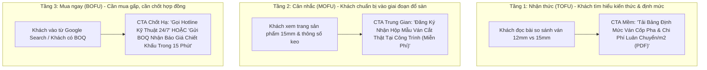

# BÁO CÁO CHUYÊN ĐỀ: MA TRẬN NIỀM TIN, GIẢM THIỂU RỦI RO, LỜI CHÀO HÀNG & CTA
**Dự án:** `vanxaydung.com` — Ván Ép Cốp Pha Phủ Phim  
**Đối tượng phân tích:** Nhà thầu xây dựng dân dụng & công nghiệp, Chỉ huy trưởng, Cai thầu thi công sàn bê tông, Đại lý vật tư VLXD  
**Mục tiêu:** Chuyển hóa lưu lượng truy cập thành đơn hàng & hợp đồng cung ứng dự án khối lượng lớn

---

## 1. BÓC TÁCH TÂM LÝ & CHU KỲ RA QUYẾT ĐỊNH CỦA KHÁCH HÀNG B2B

Khách hàng mua ván ép cốp pha phủ phim **KHÔNG MUA VÌ THÍCH HAY VÌ ĐẸP**, họ mua vì:
1. **Tiến độ thi công công trình:** Xe ván phải đến chân công trình đúng giờ đã hẹn để kịp ghép cốp pha trước giờ xe bồn bê tông đến. Chậm 1 buổi là phạt tiến độ hàng chục triệu đồng.
2. **Bài toán chi phí luân chuyển/m² sàn:** Ván giá rẻ nhưng dùng được 2-3 lần đã rộp thì đắt hơn gấp đôi so với ván tiêu chuẩn luân chuyển được 8-10 lần.
3. **An toàn kết cấu sàn bê tông:** Ván bọng rỗng hoặc keo kém chất lượng sẽ bị nứt toác dưới áp lực bê tông tươi, gây võng sàn, phình cốp pha — thiệt hại đền bù hàng trăm triệu đến tiền tỷ.

---

## 2. 4 NỖI SỢ CỐT LÕI (CORE RISKS) & CHIẾN LƯỢC TRIỆT TIÊU RỦI RO

| # | Nỗi sợ & Rào cản lớn nhất của Nhà thầu | Hiện trạng trên website `vanxaydung.com` | Chiêu thức triệt tiêu rủi ro trên giao diện mới |
|---|---|---|---|
| **1** | **Sợ ván bọng rỗng ruột, tách lớp khi gặp nước bê tông tươi** làm biến dạng kết cấu bê tông. | Chỉ có vài dòng chữ quảng cáo tự khen; trang sản phẩm bị lỗi lặp văn bản keo 2 lần; không có ảnh mặt cắt ruột ván. | **Cam kết đun sôi 12–15h không tách lớp.** Hiển thị ảnh chụp phóng to mặt cắt ruột gỗ bạch đàn liền mạch (loại A không chắp vá), video luộc ván trong nồi nước sôi thử nghiệm Quatest 1. |
| **2** | **Sợ bị chậm tiến độ giao hàng** do nhà máy xa, không có xe tải riêng, thiếu hàng sẵn trong kho. | Không có thông tin vị trí kho hàng; trang cơ sở Hà Nội bị lỗi tiêu đề "Thank you"; không rõ thời gian giao hàng. | **Cam kết giao hàng hỏa tốc trong 24h tại chân công trình.** Công khai địa chỉ tổng kho 5.000m² tại Đan Phượng (Hà Nội), hình ảnh đội xe cẩu tự hành sẵn sàng bốc hàng ngày đêm. |
| **3** | **Sợ ván không đạt độ dày danh định (bị ăn bớt mm)** khiến cốp pha không chịu nổi tải trọng sàn. | Thiếu thông số dung sai kỹ thuật; không có thước kẹp đo độ dày thực tế trên trang. | **Cam kết chuẩn độ dày danh định (dung sai ±0.5mm).** Hiển thị hình ảnh thước kẹp panme đo trực tiếp tại xưởng và chính sách: *Khách hàng kiểm tra thước kẹp tại công trình trước khi xuống hàng*. |
| **4** | **Sợ bị lừa cọc bởi "cò mồi" trung gian** không có pháp nhân, không có hóa đơn VAT hợp pháp. | Xuất hiện 4 tên thương hiệu lẫn lộn (V-HOME, Tú Anh 68, Lạc Việt, Vanphuphimvn.com); mục dự án copy bài bán chung cư. | **Minh bạch 100% hồ sơ pháp lý & năng lực nhà máy.** Hiển thị mã số thuế V-HOME, ảnh cổng nhà máy Tú Anh 68, bảng xuất hóa đơn VAT đầy đủ và 6 hợp đồng cung ứng dự án thật. |

---

## 3. LỜI CHÀO HÀNG KHÔNG THỂ TỪ CHỐI (IRRESISTIBLE B2B OFFER)

Để thúc đẩy khách hàng nhấc máy gọi hoặc để lại số điện thoại ngay lần đầu tiên vào web, doanh nghiệp cần đưa ra một Lời Chào Hàng Đột Phá:

> ### 🎁 GÓI GIẢI PHÁP CỐP PHA TOÀN DIỆN CHO CÔNG TRÌNH:
> 1. **Giá Gốc Trực Tiếp Từ Nhà Máy:** Tiết kiệm 8% – 15% so với mua qua đại lý thương mại trung gian.
> 2. **Chính Sách Đổi Trả 100% Tại Chân Công Trình:** Nếu kiểm tra phát hiện ván rỗng ruột hoặc tách lớp trong 3 nước đầu, nhà máy bốc xe đổi mới 1:1 ngay trong ngày không tốn một đồng chi phí.
> 3. **Tặng Kèm Mẫu Ván Cắt Thực Tế & Bộ Test Keo Sôi:** Gửi tận văn phòng hoặc chân công trường miễn phí trong 24h để Chỉ huy trưởng & Tư vấn giám sát tự tay kiểm định.
> 4. **Hỗ Trợ Công Nợ Linh Hoạt Theo Tiến Độ:** Áp dụng cho các nhà thầu có hồ sơ năng lực tốt và hợp đồng cung ứng định kỳ.

---

## 4. MA TRẬN KÊU GỌI HÀNH ĐỘNG (CTA MATRIX THEO 3 TẦNG Ý ĐỊNH)

### Bảng cấu hình chi tiết từng nút CTA trên giao diện mới:

| Tầng phễu | Mục tiêu chuyển đổi | Văn bản nút bấm (CTA Copy) | Vị trí đặt trên giao diện | Hành động kích hoạt khi bấm |
|---|---|---|---|---|
| **BOFU (Chốt)** | Kết nối cuộc gọi khẩn cấp | **"Gọi Báo Giá 24/7"** (kèm số điện thoại) | Topbar, Header, Sticky Bottom Bar mobile | Kích hoạt cuộc gọi `tel:098xxxxxxx` |
| **BOFU (Chốt)** | Nhận bảng giá chiết khấu dự án | **"Nhận Báo Giá Dự Án"** | Hero Banner, Cuối trang chi tiết sản phẩm | Mở Popup Form RFQ 3 trường hoặc cuộn xuống form |
| **BOFU (Chốt)** | Chat trực tiếp chuyên viên kỹ thuật | **"Zalo Báo Giá 24/7"** | Nút Sticky Bottom Bar bên phải trên mobile | Mở ứng dụng Zalo chat ngay với số hotline |
| **MOFU (Thử)** | Triệt tiêu rào cản chất lượng | **"Đăng Ký Nhận Mẫu Thử Miễn Phí"** | Cạnh Bảng thông số kỹ thuật trang sản phẩm | Form nhập địa chỉ chân công trường để gửi mẫu cắt |
| **TOFU (Học)** | Thu thập lead từ bài viết kỹ thuật | **"Tải Bảng Dự Toán Cốp Pha (PDF)"** | Giữa và cuối các bài viết cẩm nang xây dựng | Nhập số điện thoại để nhận link tải tài liệu qua Zalo |
